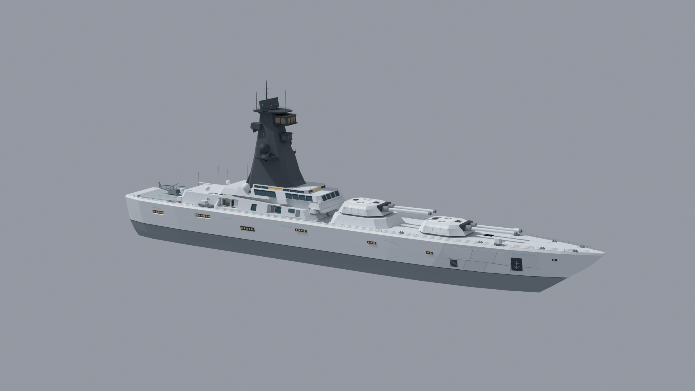
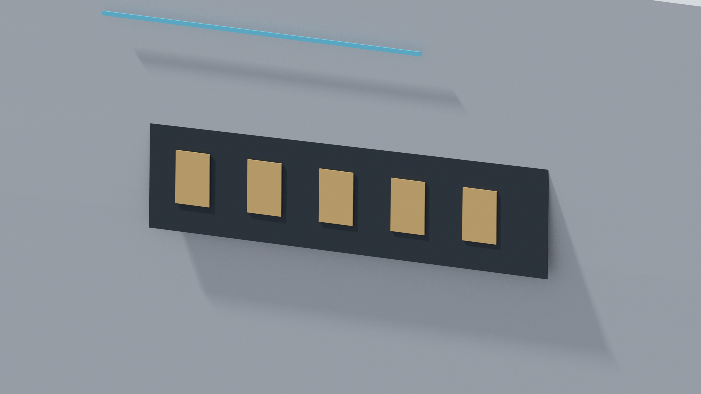
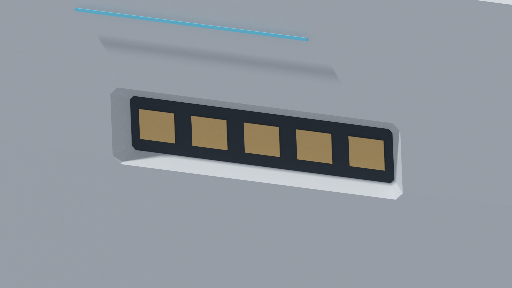
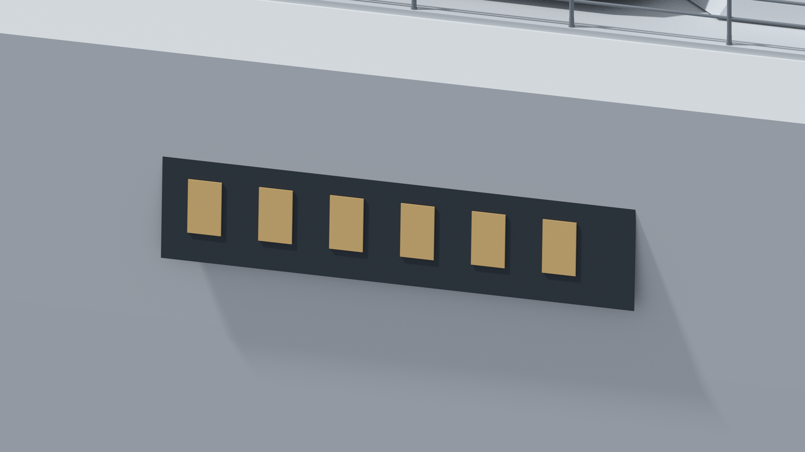
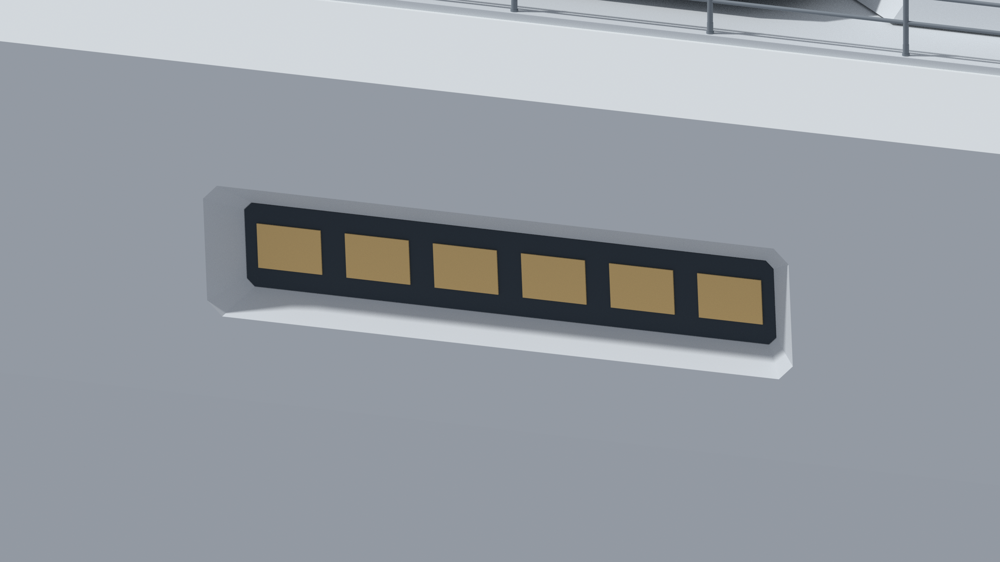
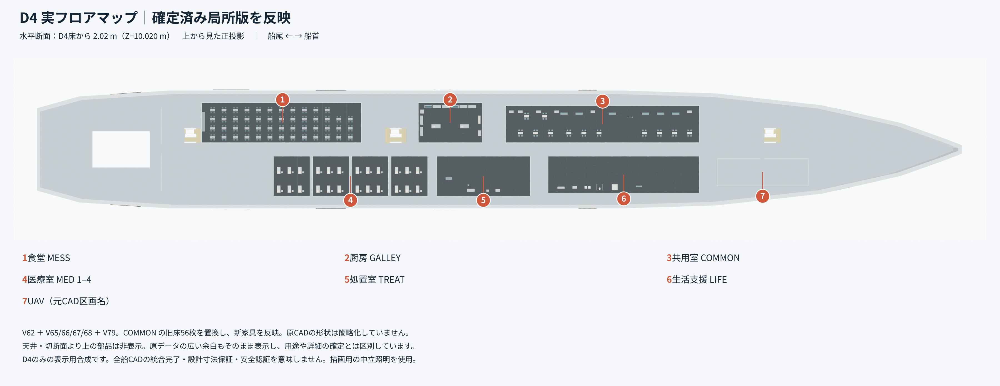
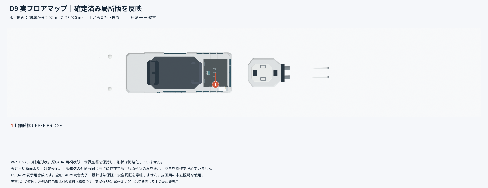

# WITNESS — 近未来戦艦 CAD

[](https://github.com/Sunwood-ai-labs/witness-battleship/actions/workflows/verify.yml)


[English](README.md) | **日本語**

[ガイド](docs/ja/guide/index.md) · [GitHub](https://github.com/Sunwood-ai-labs/witness-battleship) · [プロジェクトサイト（公開準備中）](https://sunwood-ai-labs.github.io/witness-battleship/)

[](https://github.com/Sunwood-ai-labs/witness-battleship/actions/workflows/verify.yml)

FreeCADで制作している架空の近未来艦 **WITNESS** の全体基準モデルと、船殻の限定区画を比較するCAD・画像セットです。

**全体を見るなら V62、2区画の凹部形状を調べるなら V102。両者は統合済みの同一モデルではありません。** 実船の設計・製造・強度・水密認証用ではありません。



*全体比較の After。船側の局所意匠が、艦全体のシルエットの中でどう見えるかを確認できます。この全景は比較用画像であり、V102単体に全艦の部品が入っていることを示すものではありません。*

<a id="目次"></a>

## 🧭 目次

- [スクリーンショット](#スクリーンショット)
- [クイックスタート](#クイックスタート)
- [モデル構成](#モデル構成)
- [FreeCADでの閲覧と編集](#freecadでの閲覧と編集)
- [検証](#検証)
- [制限と公開範囲](#制限と公開範囲)
- [トラブルシュート](#トラブルシュート)
- [ドキュメントと参加方法](#ドキュメントと参加方法)
- [配布の扱い](#配布の扱い)

<a id="スクリーンショット"></a>

## 🖼️ スクリーンショット

画像をクリックすると元の解像度で確認できます。Before / After は意匠比較であり、基準版への採用を意味しません。

### 全体 — シルエットを保った局所比較

| Before | After |
| :---: | :---: |
| [](images/WHOLE_BEFORE.png) | [](images/WHOLE_AFTER.png) |

**見どころ：** 同じ向きの全景で、画面左側の船側窓列と周囲の陰影を比較してください。艦橋・甲板・船首を含む全体の姿に対して、変更は局所的です。細かな凹みは下の接写が分かりやすくなっています。

### BAY0 — 5枚の暖色パネルを囲む凹部

| Before | After |
| :---: | :---: |
| [](images/BAY0_BEFORE.png) | [](images/BAY0_AFTER.png) |

**見どころ：** Beforeの外側に見える暗色帯とパネルに対し、Afterでは船殻の開口縁、下側の明るい斜面、奥にある暗色面を読み取れます。上方の水色ラインを目印に、パネル周囲の奥行きと影の変化を比べてください。

### BAY1 — 隣接する6枚のパネル列

| Before | After |
| :---: | :---: |
| [](images/BAY1_BEFORE.png) | [](images/BAY1_AFTER.png) |

**見どころ：** 画面上の甲板手すりと、6枚のパネル列の位置関係に注目してください。Afterでは外周の明るい縁と暗い背面が分かれ、平面的な貼り付け表現から凹部のある見え方へ変化しています。

### D4 — 生活・医療区画のフロアマップ

[](images/D4_FLOOR_MAP.png)

**見どころ：** 上から見た正投影で、左が船尾、右が船首。番号1〜7で食堂・厨房・共用室・医療室・処置室・生活支援・元CADのUAV区画を案内しています。家具の密度や区画間の余白も確認できます。

**画像の範囲：** D4床から2.02 m（Z=10.020 m）の水平断面を使った表示用合成です。画像内の注記は V62 と後続の局所版の反映を示しますが、それらすべてをこのリポジトリのV62へ統合したという意味ではありません。天井・切断面より上の部品は非表示です。

### D9 — 上部艦橋のフロアマップ

[](images/D9_FLOOR_MAP.png)

**見どころ：** 番号1が上部艦橋の室内範囲です。周辺には同じ高さにある可視形状も残されています。大きな暗色部分全体を室内と解釈しないでください。

**画像の範囲：** D9床から2.02 m（Z=28.920 m）の水平断面、V75の確定形状を使った表示用合成です。天井は非表示で、空白を新規の形状で埋めていません。D4・D9とも、全艦CADの統合完了や設計寸法・安全性の保証を示す図ではありません。

<a id="クイックスタート"></a>

## 🚀 クイックスタート

必要なものは **Git、Python 3、FreeCAD** です。公開FCStdは **FreeCAD 1.0R** で新規に開く検証を実施済み。他のFreeCADバージョンでの互換性は未検証です。検証・復元用Pythonスクリプトと、FreeCAD用の形状検証は実行環境が異なります。

```sh
git clone https://github.com/Sunwood-ai-labs/witness-battleship.git
cd witness-battleship
uv run python scripts/verify_files.py
```

以下は `uv` が使える環境向けです。既存のPython 3を使う場合は `uv run python` を `python`（環境によっては `python3`）に読み替えてください。

### まず限定区画を開く

FreeCADの「ファイル → 開く」で `cad/WITNESS_V102_PUBLIC.FCStd` を選びます。V102は同梱済みで、復元不要です。**船殻1部品と付属形状13部品、計14部品＋1グループ**の比較モデルです。

### 艦全体の基準モデルを開く

```sh
uv run python scripts/restore_v62.py
```

`cad/v62_parts/` の **16個の分割圧縮ファイル**から `cad/WITNESS_V62_PUBLIC.FCStd` を復元します。スクリプトは各片・結合した圧縮ファイル・復元FCStdのSHA-256を確認し、既存の出力を上書きしません。復元したFCStdをFreeCADで開いてください。V62は **35,761オブジェクト**の大きなモデルです。

詳細な手順と保存時の注意は [はじめて開く・編集する](docs/ja/guide/getting-started.md) を参照してください。

<a id="モデル構成"></a>

## 🧩 モデル構成

| 対象 | 内容・役割 | 状態 |
| --- | --- | --- |
| V62 | 艦全体の基準スナップショット、35,761オブジェクト | 16片から復元。後の局所追加をすべて含む最新版全艦ではない |
| V102 | 1つの船殻に2切削を適用した累積比較、14部品＋1グループ | 全艦組立ではない |
| 区画比較 | 14区画中2区画を個別検証 | 残り12区画は未完 |
| 基準版への採用 | 比較案を基準へ取り込んだ数 | **0区画** |
| D4 / D9 | 局所版を反映したフロアマップ画像 | 表示用合成。対応する統合済み全艦モデルの配布ではない |

```text
cad/
  WITNESS_V102_PUBLIC.FCStd   限定区画の比較モデル
  v62_parts/                 V62の16片と復元情報 PARTS.json
geometry/
  v102/                      V102の14部品BRep
  recipe/                    元船殻、2つの別案船殻、2つの除去領域
images/                      全体・BAY0・BAY1比較とD4・D9マップ（8枚）
scripts/                     復元・検証・マニフェスト管理
tests/                       Pythonユニットテスト
docs/                        操作・モデル・検証・版の説明
```

V100とV101は、それぞれ全船殻を含む排他的な別案です。V102では船殻を2つ重ねず、**除去領域だけを元船殻から引きます**。

```text
V102の船殻 = V62の元船殻 - (V62の元船殻 - V100の別案船殻)
                         - (V62の元船殻 - V101の別案船殻)
```

部品一覧と比較の読み方は [モデルガイド](docs/ja/guide/model-guide.md)、版ごとの位置付けは [版と公開範囲](docs/ja/guide/versions.md) を参照してください。

<a id="freecadでの閲覧と編集"></a>

## 🛠️ FreeCADでの閲覧と編集

1. まずV62またはV102を**単独で**開き、ツリーと全体表示を確認します。
2. 編集前に「名前を付けて保存」で作業コピーを作ります。公開配布ファイルは照合用に残してください。
3. 対象部品をツリーから選び、表示・非表示を切り替えて局所形状を確認します。
4. 形状の変更はコピー上で行い、保存後に閉じて開き直し、意図した表示と形状が残るか確認します。

FCStdで開けることと、すべての形状に完全なパラメトリック編集履歴があることは同義ではありません。BRepは形状交換・検証用で、元の編集履歴や表示設定の完全な代替ではありません。**V62とV102を重ねて「統合版」と扱わないでください。**

<a id="検証"></a>

## ✅ 検証

リポジトリのルートで実行します。

```sh
uv run python scripts/verify_files.py
uv run python scripts/check_links.py
uv run python -m unittest discover -s tests -v
uv run python scripts/update_manifest.py --check
```

- ファイル検証：配布ファイルのサイズ・SHA-256を照合します。
- リンク検証：ドキュメント内のローカル参照を確認します。
- テスト：復元・検証などのスクリプトの振る舞いを確認します。
- マニフェスト検証：記録と公開ファイルの整合を確認します。通常の閲覧者が記録を更新する必要はありません。

形状検証は別途、**FreeCADのPython環境**で `scripts/verify_geometry.py` を実行してください。14部品が有効な単一ソリッドであること、2つの除去領域の非重複、累積切削レシピとの体積差を確認します。実行方法と検証の境界は [検証記録](docs/ja/guide/verification.md) にまとめています。

<a id="制限と公開範囲"></a>

## 📐 制限と公開範囲

- 区画の検証は **2/14**、採用は **0**。この数から全艦再現率を算出しません。
- 画像は比較・配置理解用です。画像の印象だけで寸法、部品の統合状態、構造安全性を判断しないでください。
- すべての過去版、生成資料、編集履歴を含む完全アーカイブではありません。
- 公開FCStdは原本の複製から非公開メタデータを除いた派生版です。原本は変更していません。
- 全艦の動作、強度、水密、製造適合性、安全認証は検証対象外です。
- FreeCAD 1.0R以外での動作、必要メモリの一律の下限、全OSでの動作は保証していません。

<a id="トラブルシュート"></a>

## 🔧 トラブルシュート

| 症状 | 確認すること |
| --- | --- |
| V62のFCStdが見つからない | `uv run python scripts/restore_v62.py` を実行。16片がすべて取得されているか確認 |
| 復元で「既存の出力」があると止まる | 上書き防止の正常動作。編集中のファイルを退避し、既存ファイルの由来を確認してから再実行 |
| サイズ・SHA-256不一致 | 作業を止め、欠損または意図しない変更を確認。失敗を隠すためにマニフェストを更新しない |
| `No module named FreeCAD` / `Part` | 通常のPythonではなくFreeCADのPython環境で形状検証を実行 |
| V62を開くのに時間がかかる | 35,761オブジェクトのモデルです。他の大きな文書を閉じ、まずV102を単独で確認 |
| V102に艦橋や砲塔などがない | 全艦組立ではなく、船殻＋13付属形状の比較モデルなので仕様どおり |
| 形状が二重・ちらついて見える | 基準版と比較案を同じ表示に重ねていないか確認 |
| PNGとCADの見え方が違う | 画像は比較・表示用合成を含みます。版、表示状態、カメラ、照明の違いを切り分ける |

<a id="ドキュメントと参加方法"></a>

## 📚 ドキュメントと参加方法

- [はじめて開く・編集する](docs/ja/guide/getting-started.md)：取得、復元、FreeCADでの確認と保存
- [モデルガイド](docs/ja/guide/model-guide.md)：V102の部品と切削レシピ、画像との関係
- [検証記録](docs/ja/guide/verification.md)：確認済み事項と検証対象外
- [版と公開範囲](docs/ja/guide/versions.md)：V62 / V100 / V101 / V102の位置付け
- [変更提案・不具合報告](CONTRIBUTING.md)：再現に必要な情報と提出前の確認
- [変更履歴](CHANGELOG.md)：公開セットの変更

<a id="配布の扱い"></a>

## 📜 配布の扱い

公開リポジトリ化はオープンソースライセンスの付与を意味しません。この公開準備では新たなライセンスを設定していません。再利用・再配布等の権利は、公開されていることだけから判断しないでください。FreeCAD等の依存ソフトは同梱せず、それぞれの公式配布元を利用してください。
