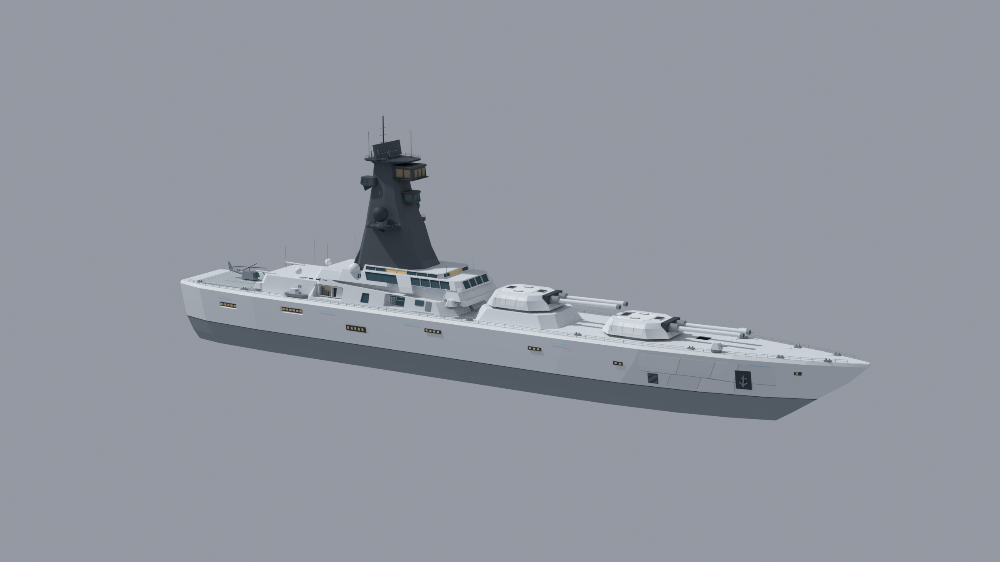
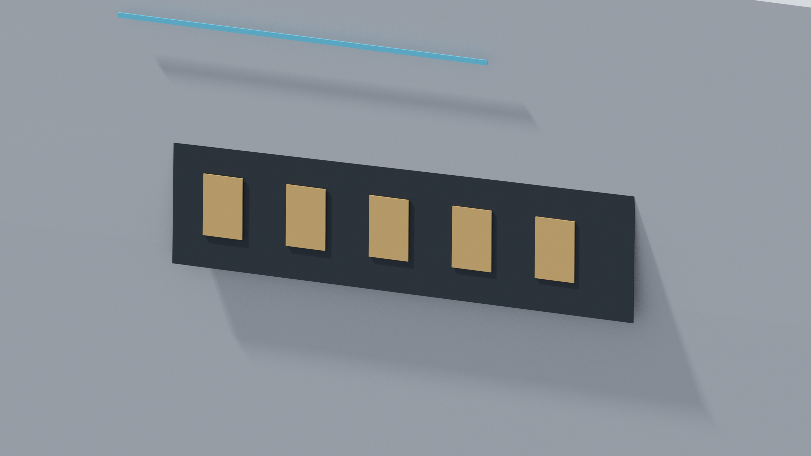
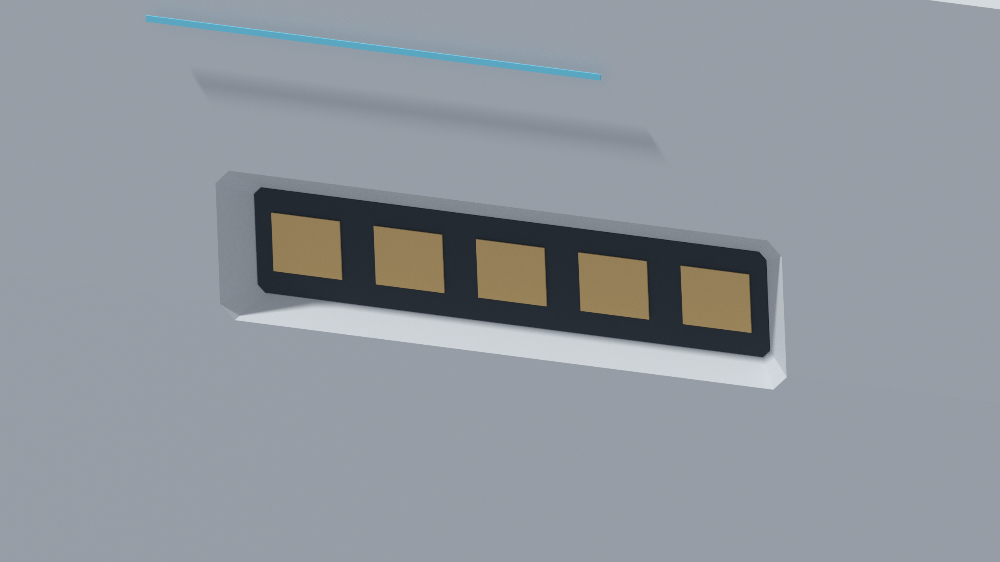
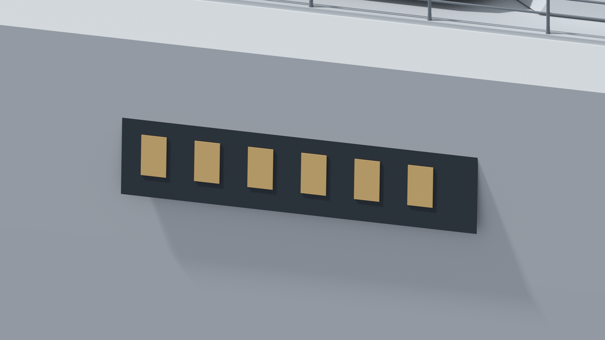
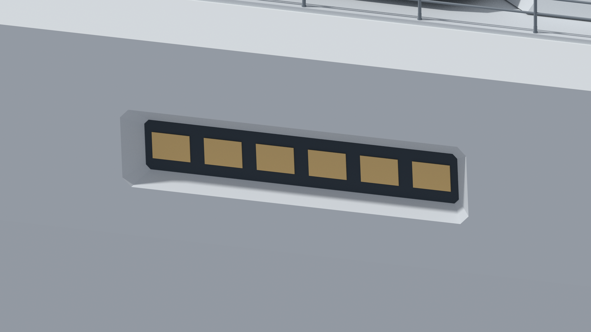
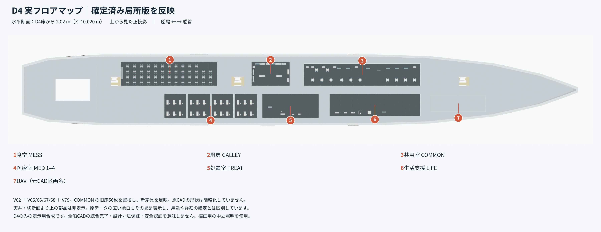
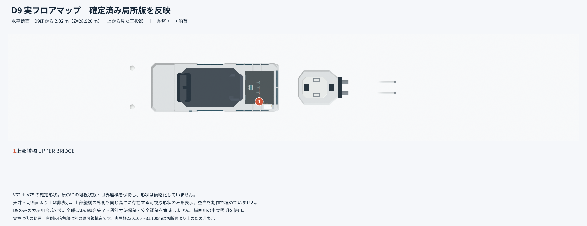

# WITNESS — Near-future battleship CAD

[](https://github.com/Sunwood-ai-labs/witness-battleship/actions/workflows/verify.yml)


**English** | [日本語](README.ja.md)

[Guide](docs/guide/index.md) · [GitHub](https://github.com/Sunwood-ai-labs/witness-battleship) · [Project site (deployment pending)](https://sunwood-ai-labs.github.io/witness-battleship/)

A FreeCAD model of the fictional near-future ship **WITNESS**, combining a whole-ship baseline with CAD and images for a limited hull-bay design comparison.

**Open V62 for the whole-ship baseline; open V102 to inspect two recessed bays. They are not one integrated model.** This is not a real-vessel design, manufacturing package, or structural/watertight certification.



*The After view shows local hull styling in the context of the ship's silhouette. It is a comparison image, not evidence that the V102 file contains the complete ship assembly.*

<a id="contents"></a>

## 🧭 Contents

- [Screenshots](#screenshots)
- [Quick start](#quick-start)
- [Model structure](#model-structure)
- [Viewing and editing in FreeCAD](#viewing-and-editing)
- [Verification](#verification)
- [Limits and public scope](#limits)
- [Troubleshooting](#troubleshooting)
- [Documentation and contributions](#documentation)
- [Distribution and rights](#rights)

<a id="screenshots"></a>

## 🖼️ Screenshots

Select an image to inspect the original resolution. Before / After means a design comparison, **not adoption into the baseline**.

### Whole ship — local changes within the silhouette

| Before | After |
| :---: | :---: |
| [](images/WHOLE_BEFORE.png) | [](images/WHOLE_AFTER.png) |

**Look for:** the window rows toward the left of the image and their surrounding shadows. The bridge, deck, and bow provide context; the changes are local. Use the close-ups below to read the recesses more clearly.

### BAY0 — a recess around five warm-colored panels

| Before | After |
| :---: | :---: |
| [](images/BAY0_BEFORE.png) | [](images/BAY0_AFTER.png) |

**Look for:** the opening edge, bright lower slope, and dark recessed back in After, compared with the outward-looking strip and panels in Before. The cyan line above the bay provides a useful visual reference for depth and shadow changes.

### BAY1 — the adjacent six-panel row

| Before | After |
| :---: | :---: |
| [](images/BAY1_BEFORE.png) | [](images/BAY1_AFTER.png) |

**Look for:** the relationship between the deck railing above and the six-panel row. In After, the light perimeter and dark back separate visually, changing the appearance from a surface-mounted detail to a recess.

### D4 — living and medical spaces

[](images/D4_FLOOR_MAP.png)

**Look for:** a top-down orthographic view with stern to the left and bow to the right. Labels 1–7 identify the mess, galley, common room, medical rooms, treatment room, life-support area, and the original CAD's UAV zone. Furniture density and the spaces between zones remain visible.

**Image scope:** a display composite using a horizontal cut 2.02 m above the D4 floor (Z=10.020 m). Its annotations refer to V62 and later local versions; they do not mean all those versions have been integrated into the distributed V62. Ceilings and objects above the cut are hidden.

### D9 — upper bridge

[](images/D9_FLOOR_MAP.png)

**Look for:** label 1 marks the upper-bridge interior. Other visible geometry at the same elevation remains in the image. Do not interpret the entire large dark region as interior space.

**Image scope:** a display composite using confirmed V75 geometry and a cut 2.02 m above the D9 floor (Z=28.920 m). Ceilings are hidden, and empty areas have not been filled with invented geometry. Neither floor map certifies a fully integrated ship, design dimensions, or safety.

<a id="quick-start"></a>

## 🚀 Quick start

You need **Git, Python 3, and FreeCAD**. The public FCStd files were freshly opened in **FreeCAD 1.0R**; other FreeCAD versions are unverified. Standard-Python checks and FreeCAD geometry checks use different execution environments.

```sh
git clone https://github.com/Sunwood-ai-labs/witness-battleship.git
cd witness-battleship
uv run python scripts/verify_files.py
```

The examples prefer `uv`. With an existing Python 3 installation, replace `uv run python` with `python` or `python3` as appropriate.

### Open the limited comparison first

In FreeCAD, choose **File → Open** and select `cad/WITNESS_V102_PUBLIC.FCStd`. It is included directly; no restoration is required. It contains **one hull and 13 attached shapes: 14 parts plus one group**.

### Open the whole-ship baseline

```sh
uv run python scripts/restore_v62.py
```

This restores `cad/WITNESS_V62_PUBLIC.FCStd` from **16 compressed fragments** in `cad/v62_parts/`. The script checks SHA-256 hashes for every fragment, the combined archive, and the restored FCStd. It refuses to overwrite an existing output. Open the restored file in FreeCAD; V62 is a large model with **35,761 objects**.

See [Getting started](docs/guide/getting-started.md) for the full workflow and safe editing practices.

<a id="model-structure"></a>

## 🧩 Model structure

| Item | Role | Status |
| --- | --- | --- |
| V62 | Whole-ship baseline snapshot, 35,761 objects | Restored from 16 fragments; not a latest ship containing every later local addition |
| V102 | Cumulative comparison applying two cuts to one hull; 14 parts plus one group | Not a full ship assembly |
| Bay comparison | Two of 14 bays individually verified | Remaining 12 incomplete |
| Baseline adoption | Compared bays incorporated into the baseline | **Zero bays** |
| D4 / D9 | Floor-map images incorporating local versions | Display composites, not a distributed integrated ship model |

```text
cad/
  WITNESS_V102_PUBLIC.FCStd   Limited bay comparison
  v62_parts/                 16 V62 fragments and PARTS.json
geometry/
  v102/                      14 V102 part BReps
  recipe/                    Base hull, two alternatives, two removal regions
images/                      Whole/BAY0/BAY1 comparisons and D4/D9 maps (8 images)
scripts/                     Restoration, verification, manifest maintenance
tests/                       Python unit tests
docs/                        Bilingual guides and retained original documentation
```

V100 and V101 are mutually exclusive alternatives, each containing an entire hull. V102 **subtracts their removal regions from the base hull** instead of overlaying two hulls.

```text
V102 hull = V62 base hull - (V62 base hull - V100 alternative hull)
                         - (V62 base hull - V101 alternative hull)
```

See the [Model guide](docs/guide/model-guide.md) for part details and [Versions and public scope](docs/guide/versions.md) for the meaning of each version.

<a id="viewing-and-editing"></a>

## 🛠️ Viewing and editing in FreeCAD

1. Open V62 or V102 **on its own** and inspect the model tree and overall view.
2. Before editing, use **Save As** to create a working copy. Keep distributed files for comparison and integrity checks.
3. Select components in the tree and toggle visibility to inspect the local geometry.
4. Edit the copy, save it, close it, and open it afresh to check that the intended geometry and display state remain.

An editable FCStd document does not imply a complete parametric history for every shape. BRep files support shape exchange and verification; they do not replace the original editing history or display settings. **Do not overlay V62 and V102 and call the result an integrated version.**

<a id="verification"></a>

## ✅ Verification

Run from the repository root:

```sh
uv run python scripts/verify_files.py
uv run python scripts/check_links.py
uv run python -m unittest discover -s tests -v
uv run python scripts/update_manifest.py --check
```

- File verification compares distributed file sizes and SHA-256 hashes.
- Link verification checks local documentation references, not external URLs or page anchors.
- Tests check the behavior of restoration and verification utilities.
- Manifest checking compares recorded metadata with the public files; readers do not need to update it.

Separately, run `scripts/verify_geometry.py` in **FreeCAD's Python environment**. It checks 14 valid single-solid parts, non-overlapping removal regions, and the volume difference against the cumulative two-cut recipe. See [Verification](docs/guide/verification.md) for instructions and limits.

<a id="limits"></a>

## 📐 Limits and public scope

- **2/14 bays** compared and verified; **zero adopted**. These counts do not measure whole-ship completeness.
- Images support visual comparison and spatial understanding, not dimensional, integration, or structural guarantees.
- This is not a complete archive of all past versions, generation sources, or editing history.
- Public FCStd files are derivatives of copies with private metadata removed. Source originals remain unchanged.
- Whole-ship operation, strength, watertightness, manufacturing suitability, and safety certification are outside scope.
- Compatibility beyond FreeCAD 1.0R, a universal minimum-memory requirement, and operation on every OS are not guaranteed.

<a id="troubleshooting"></a>

## 🔧 Troubleshooting

| Symptom | What to check |
| --- | --- |
| V62 FCStd is missing | Run `uv run python scripts/restore_v62.py`; confirm all 16 fragments were downloaded |
| Restoration stops because output exists | Intended overwrite protection. Preserve edited work and identify the existing file before retrying |
| Size or SHA-256 mismatch | Stop and investigate missing data or unintended edits. Do not regenerate the manifest merely to hide the failure |
| `No module named FreeCAD` / `Part` | Run geometry checks in FreeCAD's Python environment, not ordinary Python |
| V62 takes time to open | It has 35,761 objects. Close other large documents and try V102 alone first |
| V102 has no complete bridge or turrets | Expected: it is a hull plus 13 attached shapes, not a full ship assembly |
| Double surfaces or flickering | Check that baseline and alternative hulls are not overlaid |
| CAD looks different from a PNG | Images include comparison/display composites. Check version, visibility, camera, and lighting separately |

<a id="documentation"></a>

## 📚 Documentation and contributions

- [Guide index](docs/guide/index.md): English documentation and language switches
- [Getting started](docs/guide/getting-started.md): download, restore, open, and save safely
- [Model guide](docs/guide/model-guide.md): V102 parts, recipe, and image interpretation
- [Verification](docs/guide/verification.md): checked properties and exclusions
- [Versions and public scope](docs/guide/versions.md): V62 / V100 / V101 / V102
- [Contribution guide (Japanese)](CONTRIBUTING.md): reporting and pre-submission checks
- [Changelog (Japanese)](CHANGELOG.md): public-set changes

<a id="rights"></a>

## 📜 Distribution and rights

Publishing a repository is not an open-source license grant. No new license has been assigned in this preparation. Do not infer reuse or redistribution rights merely from public availability. Dependencies such as FreeCAD are not bundled; obtain them from their official distributors.
